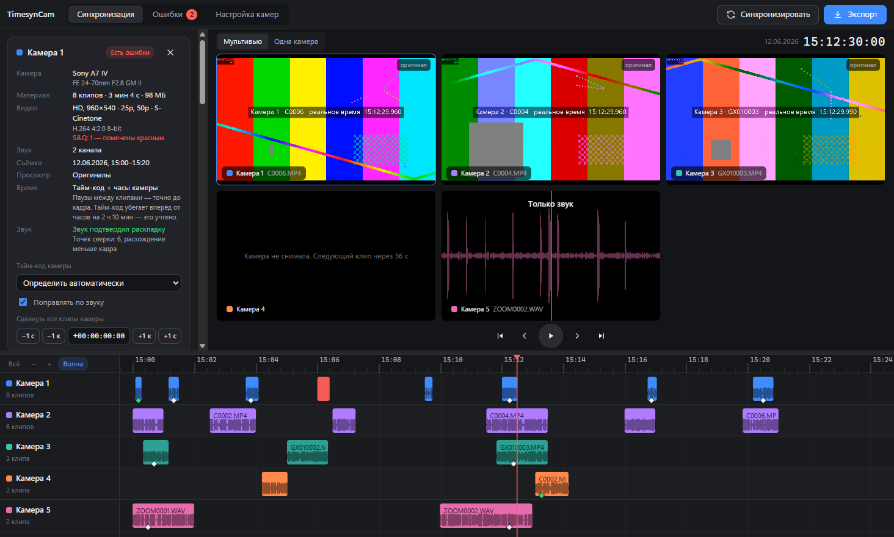
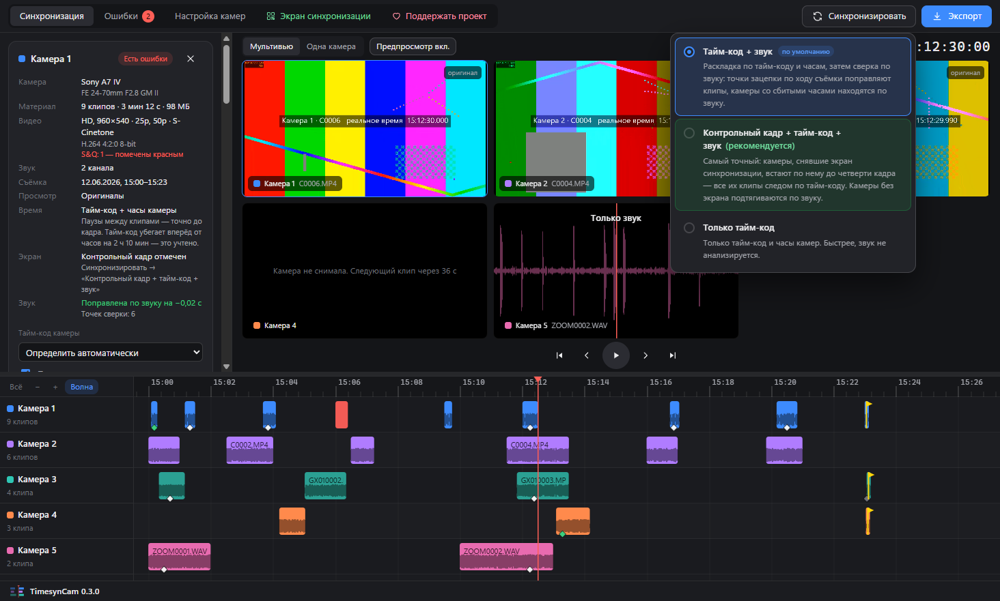
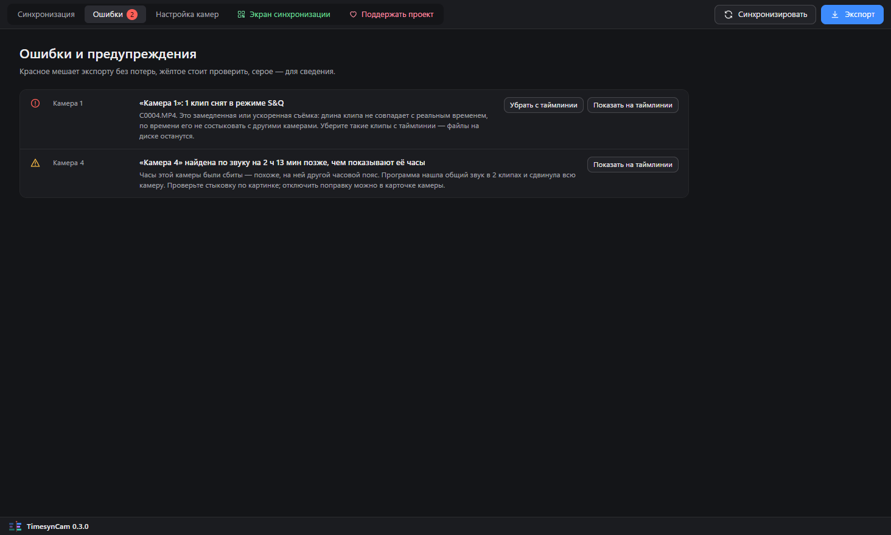
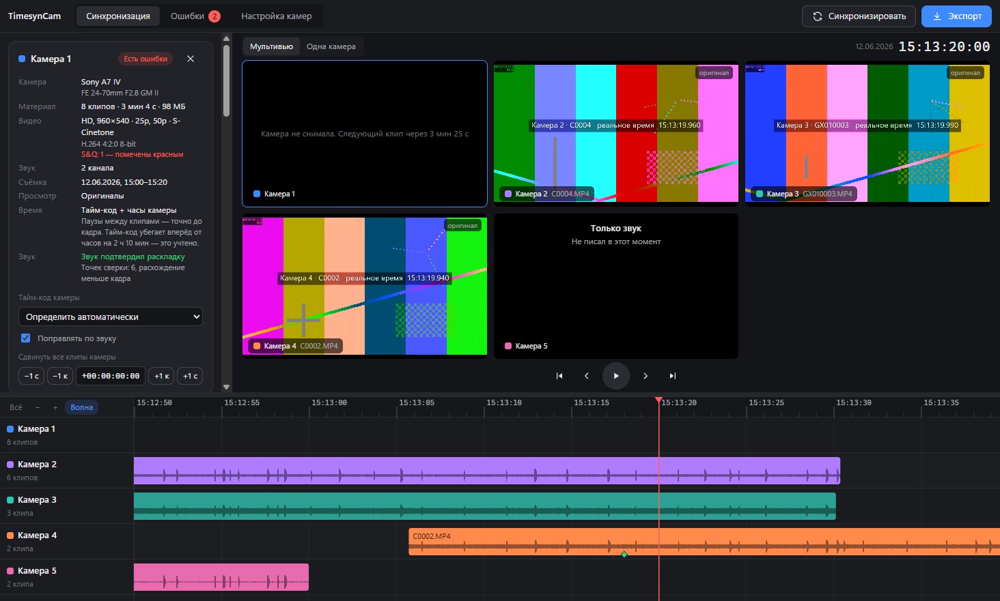

<p align="center">
  
</p>

<h1 align="center">TimesynCam</h1>

<p align="center">
  Раскладывает клипы с нескольких камер по реальному времени съёмки и отдаёт готовую таймлинию в DaVinci Resolve и Premiere Pro.<br>
  Для камер без внешнего тайм-кода — Sony A7 IV и подобных — вместе с камерами, у которых тайм-код есть.
</p>

<p align="center">
  <a href="https://github.com/agrebru-glitch/timesyncam/releases/latest"></a>
  <a href="https://github.com/agrebru-glitch/timesyncam/actions/workflows/ci.yml"></a>
  <a href="LICENSE"></a>
  
</p>



## Зачем

Съёмка в несколько камер без общего тайм-кода — обычное дело: A7 IV не принимает внешний тайм-код, у GoPro его нет, рекордер звука живёт своей жизнью. На монтаже всё это приходится раскладывать по таймлинии вручную: искать хлопки, сдвигать клипы, следить, чтобы ничего не уехало.

TimesynCam делает эту работу за вас. Перетащите папку каждой камеры на свою дорожку, нажмите «Синхронизировать» — и клипы встанут туда, где они были сняты, с настоящими паузами между дублями. Остаётся проверить результат в мультивью и сохранить таймлинию для монтажки.

## Возможности

- **Своя дорожка для каждой камеры.** Несколько карт одной камеры — на одну дорожку.
- **Камеры с тайм-кодом и без.** Камера с синхронизированным тайм-кодом (Tentacle, jam sync) становится опорной, остальные выравниваются по своим часам.
- **Точность до кадра там, где это возможно.** Если тайм-код камеры идёт непрерывно (Free Run), паузы между клипами точны до кадра, даже когда сам тайм-код не совпадает с реальным временем.
- **Сверка по звуку.** После раскладки по тайм-коду программа сверяет камеры по общему звуку: точки зацепки по ходу съёмки поправляют клипы, а камеры со сбитыми часами или чужим часовым поясом находятся по звуку во всей записи. Режим выбирается по кнопке «Синхронизировать».
- **Волна звука на клипах.** Приблизьте таймлинию — хлопки разных камер встанут на одну вертикаль, стыковку видно глазами.
- **Ручная подгонка.** Сдвиг всех клипов камеры сразу — по кадру или по секунде.
- **Мультивью и одна камера.** Экранов ровно столько, сколько камер. Без прокси клипы показываются стоп-кадрами, у рекордера вместо видео — волна звука вокруг курсора.
- **Удаление клипа с таймлинии** — правой кнопкой по клипу или клавишей Delete. Файл на диске остаётся, вернуть клип можно в карточке камеры.
- **Понятные ошибки.** Клипы S&Q подсвечиваются красным, их можно убрать с таймлинии одной кнопкой. Смена разрешения и частоты кадров внутри камеры — норма, программа на неё не ругается.
- **Экспорт для Resolve и Premiere Pro.** XML-таймлиния: каждая камера на своей дорожке, тайм-код таймлинии — время суток.
- **Оригиналы не трогаются.** Программа только читает файлы. В XML — ссылки на клипы и их места на таймлинии.
- **Справка по настройке камер** прямо в программе.

## Скачать

Последняя версия — на странице [Релизы](https://github.com/agrebru-glitch/timesyncam/releases/latest).

| Файл | Что это |
|---|---|
| `TimesynCam-Setup-<версия>.exe` | Установщик для Windows 10 и 11 (64 бит) |
| `TimesynCam-<версия>-win-x64.zip` | Та же программа без установки: распакуйте и запустите `TimesynCam.exe` |

FFmpeg уже внутри, отдельно ставить ничего не нужно.

> [!NOTE]
> Программа пока не подписана цифровым сертификатом, поэтому при первом запуске Windows может показать окно «Система Windows защитила ваш компьютер». Нажмите «Подробнее» → «Выполнить в любом случае». Контрольные суммы файлов — в `SHA256SUMS.txt` рядом с релизом.

Версия для macOS запланирована.

## Как пользоваться

1. **Добавьте камеры.** Перетащите папку с клипами камеры на дорожку «Камера 1». Для следующей камеры — на «Добавить камеру». Двойной щелчок по имени камеры — переименовать.
2. **Нажмите «Синхронизировать»** и выберите **«Тайм-код + звук»** (по умолчанию) или **«Только тайм-код»**. Кнопка подсвечивается, когда появились новые клипы. Программа разложит клипы по времени, сверит по звуку и расскажет в карточке каждой камеры, откуда она взяла время и что поправил звук.
3. **Загляните во вкладку «Ошибки».** Там клипы S&Q, наложения и подсказки — у каждой строки есть кнопка, которая это исправит.
4. **Проверьте стыковку по хлопку.** В мультивью поставьте курсор на хлопок, стрелками ← → найдите кадр. Если камера расходится — сдвиньте её кнопками «−1 к» / «+1 к» в карточке.
5. **Нажмите «Экспорт».** Кнопка становится доступной только после синхронизации. Выберите частоту и разрешение таймлинии и сохраните XML.
6. **Откройте в монтажке.** DaVinci Resolve: `File → Import → Timeline…`. Premiere Pro: `File → Import…`.

| Клавиша | Действие |
|---|---|
| Пробел | Воспроизведение / пауза |
| ← → | Кадр назад / вперёд |
| Shift + ← → | Секунда назад / вперёд |
| Home / End | Начало / конец съёмки |
| Delete | Удалить выделенный клип с таймлинии (файл на диске останется) |
| Ctrl + колесо | Масштаб таймлинии вокруг курсора — приблизьте, чтобы сравнить волны звука |

<p align="center"> </p>

## Как программа понимает время

Для каждой камеры программа выбирает лучший источник и честно пишет его в карточке:

| Источник | Когда | Точность |
|---|---|---|
| **Точный тайм-код** | Тайм-код совпадает с часами камеры или вы отметили его как синхронизированный | до кадра, камера опорная |
| **Тайм-код + часы камеры** | Тайм-код идёт непрерывно (Free Run), но не совпадает с реальным временем | паузы до кадра, время суток ±1 с |
| **Только часы камеры** | Тайм-кода нет или он шёл только во время записи (Rec Run) | около секунды |

Затем, в режиме «Тайм-код + звук», программа сверяет камеры по звуку. Первая точка зацепки задаёт поправку для своего клипа и всех следующих; следующая точка сверяет кадр и при расхождении меняет поправку со своего клипа, не трогая предыдущие. Сравниваются «атаки» звука — хлопки, удары, начала слов, — поэтому совпадают и встроенный микрофон камеры, и рекордер. Точность — около четверти кадра.



Подробно — в [docs/how-it-works.md](docs/how-it-works.md).

## Камеры и форматы

| Камеры | Что читается |
|---|---|
| Sony (A7 IV, A7S III, A7C II, A1, FX3, FX30, FX6…) | XML рядом с клипом: тайм-код, время съёмки, модель, объектив, гамма, S&Q |
| Canon, Panasonic, Fujifilm, Nikon, Blackmagic | Тайм-код из MOV / MP4 / MXF, время создания файла |
| GoPro, DJI | Время съёмки с учётом их особенностей, время из имени файла DJI |
| iPhone, Android | Время съёмки с часовым поясом, время из имени файла |
| Рекордеры Zoom, Tascam, Sound Devices… | WAV с меткой времени (BWF) |

Кодеки: H.264, H.265, ProRes, DNxHD/HR, MPEG-2, AV1, VP9, CineForm и другие, которые читает FFmpeg. BRAW, R3D, Canon RAW и ARRIRAW пока не читаются — их нужно перегнать. Подробно — в [docs/formats.md](docs/formats.md).

## Настройка камер Sony

Коротко, чтобы всё стыковалось до кадра:

1. Выставьте **одинаковые часы** на всех камерах — по одному телефону, с точностью до секунды.
2. **TC Run → Free Run**, **TC Make → Preset**, **TC Preset** — примерно текущее время.
3. **User Bit Time Rec** — включить.
4. Не выключайте **встроенный микрофон** (уровень записи — не на нуле): по нему программа сверяет камеры. Сделайте **хлопок** в начале и после перерывов.
5. **Прокси-запись** — включить (XAVC S HD), чтобы предпросмотр работал быстро.
6. Копируйте **карту целиком**, вместе с файлами `M01.XML`.

Пункты меню, объяснения и советы для других камер — в [docs/camera-setup.md](docs/camera-setup.md) и во вкладке «Настройка камер» в программе.

## Попробовать без своей съёмки

```bash
npm run demo
```

Скрипт создаст демо-съёмку из пяти «камер»: Sony A7 IV с XML и одним клипом S&Q, Sony FX3 с точным тайм-кодом, GoPro с отстающими часами, Sony A7 III с чужим часовым поясом и рекордер Zoom. Все они пишут один звук площадки, а в кадр впечатано настоящее время съёмки — по нему видно, насколько точно встали камеры. Нужен FFmpeg в `PATH`.

## Для разработчиков

Нужны Node.js 22 или новее и FFmpeg (в `PATH` или в папке `bin` рядом с проектом).

```bash
npm install
npm start          # собрать и запустить
npm run dev        # режим разработки с перезагрузкой интерфейса
npm test           # тесты
npm run typecheck  # проверка типов
npm run dist       # установщик и архив в папке release
```

Проверка без интерфейса:

```bash
node scripts/scan-cli.mts "<папка камеры 1>" "<папка камеры 2>" --xml timeline.xml
```

Устройство проекта:

- `src/core` — чтение метаданных, синхронизация, экспорт. Без Electron, покрыто тестами.
- `src/main` — Electron: сканирование папок, вызовы FFmpeg, доступ плеера к видео.
- `src/renderer` — интерфейс на React.
- `test` — тесты на `node --test`.
- `scripts` — сборка, демо-съёмка, проверка из консоли, иконка.

Как помочь проекту — в [CONTRIBUTING.md](CONTRIBUTING.md). Особенно нужны примеры метаданных камер, которые программа читает плохо: для этого есть шаблон задачи «Поддержка камеры».

## Планы

- Подгонка по отметке: поставили точку на хлопке у двух камер — программа совместила их сама.
- Поправка на расстояние между камерами при сверке по звуку.
- Экспорт в FCPXML и OpenTimelineIO, сборка таймлинии прямо в DaVinci Resolve.
- Версия для macOS.

История изменений — в [CHANGELOG.md](CHANGELOG.md).

## Лицензия

TimesynCam — свободная программа: её можно использовать, изучать, изменять и распространять на условиях [GNU GPL версии 3](LICENSE) или любой более поздней версии.

В сборку для Windows входит FFmpeg под лицензией LGPL. Подробности о сторонних компонентах — в [THIRD_PARTY_NOTICES.md](THIRD_PARTY_NOTICES.md).

## Автор

Andrey Grebenikov
