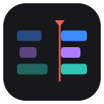
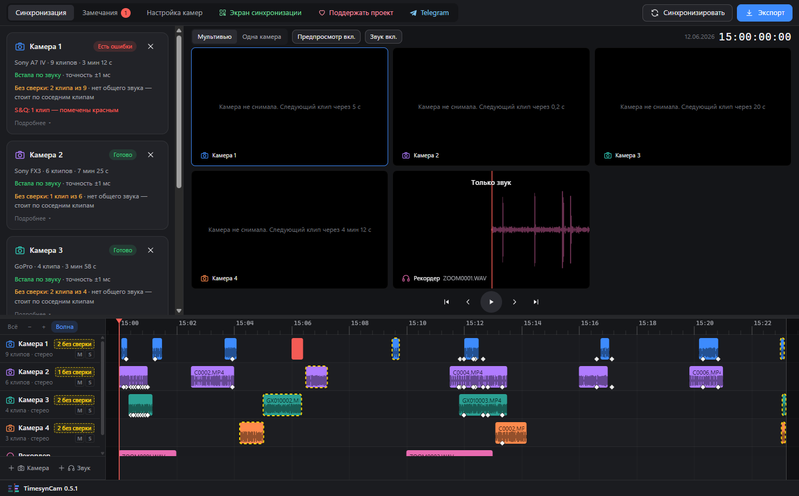
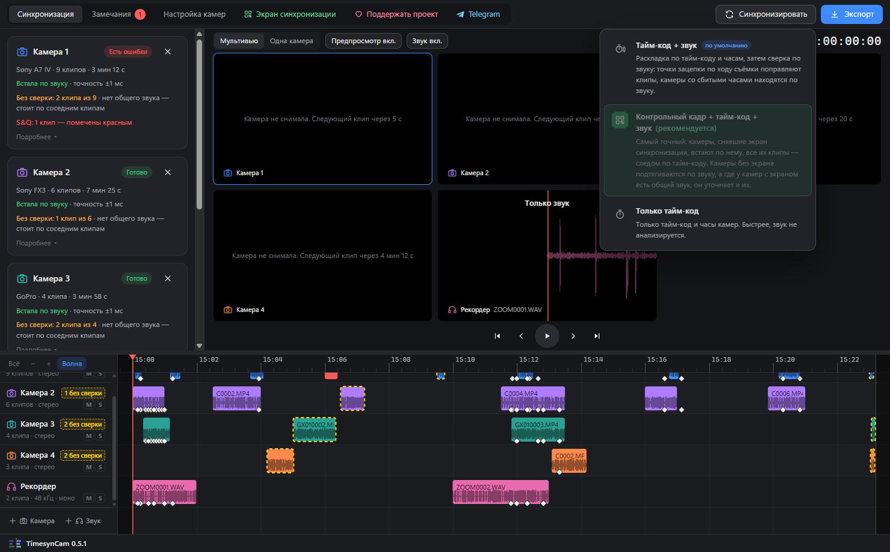
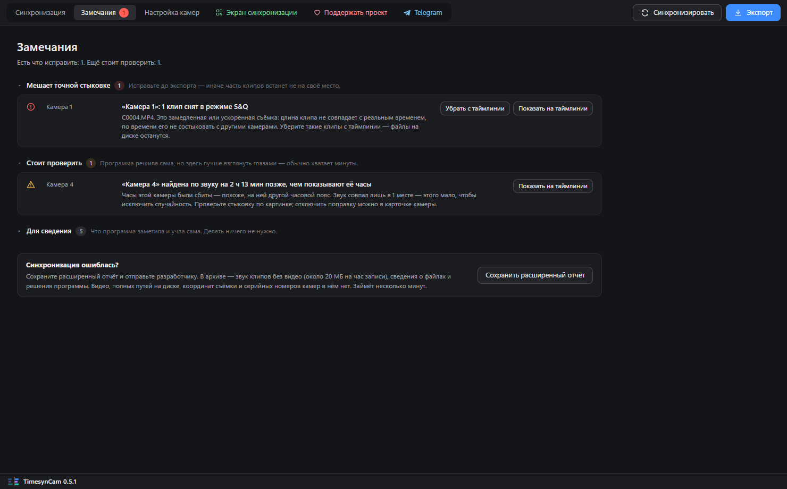
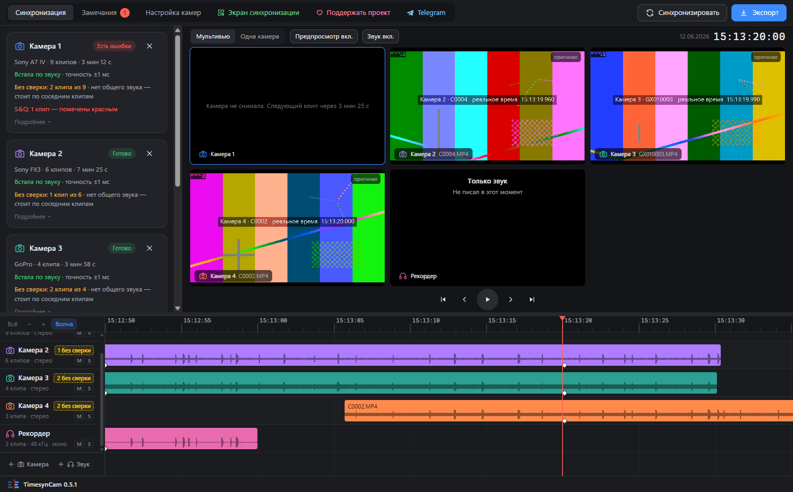
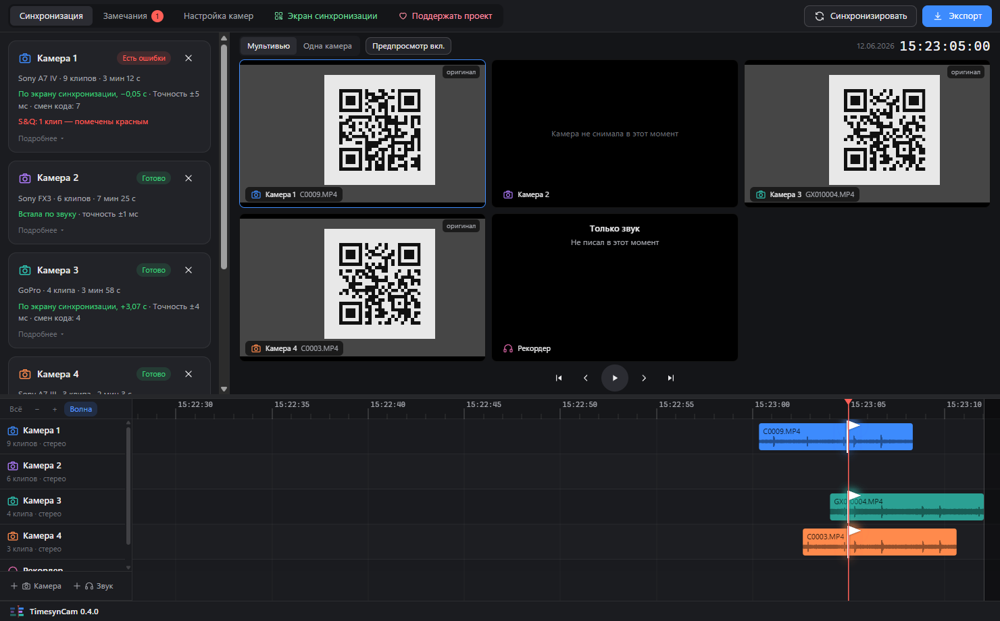

<p align="center">
  
</p>

<h1 align="center">TimesynCam</h1>

<p align="center">
  Синхронизирует клипы нескольких камер и рекордеров по времени съёмки и звуку и отдаёт готовую таймлинию в DaVinci Resolve и Premiere Pro.<br>
  Для камер без общего тайм-кода — Sony A7 IV, GoPro, телефонов — и вместе с камерами, у которых он есть.
</p>

<p align="center">
  <a href="https://github.com/agrebru-glitch/timesyncam/releases/download/v0.5.4/TimesynCam-Setup-0.5.4.exe"></a>
  &nbsp;
  <a href="https://github.com/agrebru-glitch/timesyncam/releases/tag/v0.5.2"></a>
</p>

<p align="center">
  <a href="https://github.com/agrebru-glitch/timesyncam/releases/download/v0.4.0/TCoder-0.4.0.apk">TCoder — экран синхронизации на Android</a> ·
  <a href="https://github.com/agrebru-glitch/timesyncam/releases/download/v0.5.4/TimesynCam-0.5.4-win-x64.zip">Windows без установки (zip)</a> ·
  <a href="https://github.com/agrebru-glitch/timesyncam/releases">Все версии</a>
</p>

<p align="center">
  <a href="https://github.com/agrebru-glitch/timesyncam/releases/latest"></a>
  <a href="https://github.com/agrebru-glitch/timesyncam/actions/workflows/ci.yml"></a>
  <a href="LICENSE"></a>
  
  
  <a href="#поддержать-проект"></a>
  <a href="https://t.me/timesyncam"></a>
</p>



## Зачем

Снимаете в несколько камер, а общего тайм-кода нет: A7 IV не принимает внешний тайм-код, у GoPro его нет вовсе, рекордер пишет по своим часам. На монтаже всё это приходится раскладывать по таймлинии руками: искать хлопки, двигать клипы, следить, чтобы ничего не уехало.

TimesynCam делает это за вас. Перетащите папку съёмки, нажмите «Синхронизировать» — клипы встанут туда, где их сняли, с настоящими паузами между дублями. Остаётся проверить стыковку в мультивью и сохранить таймлинию для монтажки.

## Что умеет

**Раскладывает материал по дорожкам**

- **Каждая папка — своя дорожка.** Перетащите папку съёмки целиком: «кам 1», «кам 2», «звук» внутри станут отдельными дорожками с этими же именами. Карты одной камеры программа соберёт на одну дорожку по серийному номеру. Папку, брошенную на дорожку с клипами, добавит к ней.
- **Каналы рекордера — отдельными строками.** ZOOM0001_Tr1 и _Tr2 — одна запись: сверяются вместе, а на таймлинии и в монтажке каждый канал своей строкой со своими M и S.
- **Порядок дорожек — по количеству материала.** Сверху камеры, у которых материала меньше, ниже — основная, звук — под камерами.
- **Звук любых рекордеров:** WAV с меткой времени (BWF, RF64), M4A, MP3, FLAC, AIFF и другие форматы, которые читает FFmpeg.

**Ставит клипы по времени**

- **По тайм-коду и часам.** Камера с тайм-кодом от генератора (Tentacle, jam sync) становится опорной. Тайм-код в режиме Free Run даёт паузы между клипами точно до кадра, даже если сам он не совпадает с часами.
- **По звуку.** Программа сверяет камеры по общему звуку и поправляет каждый клип; камеры со сбитыми часами или чужим часовым поясом находит по звуку во всей записи. Длинную запись рекордера сверяет в нескольких местах.
- **По экрану синхронизации.** Программа показывает QR-код с точным временем. Снимите его каждой камерой 5–10 секунд — до или после съёмки — и камеры встанут по нему с точностью до кадра-двух, даже без общего звука.

**Помогает проверить**

- **Мультивью и звук всех дорожек.** Экранов столько, сколько камер. При проигрывании звучат все дорожки на своих местах: совпавшие записи звучат как одна, разошедшиеся — эхом. M и S у дорожки выключают её звук или оставляют только её.
- **Волна звука на клипах.** Приблизьте таймлинию — хлопки разных камер встанут на одну вертикаль.
- **Честные пометки.** Клипы, место которых звук не подтвердил, обведены жёлтым пунктиром — обычно они стоят верно, но проверить стоит. Клипы, рядом с которыми другие устройства не писали, помечены серой точкой: сверять их не с чем. Клипы S&Q — красным, их можно убрать с таймлинии одной кнопкой.
- **Вкладка «Замечания»** — что исправить и что проверить, у каждой строки есть кнопка, которая это делает.

**Отдаёт в монтажку**

- **DaVinci Resolve:** FCPXML — стерео одной дорожкой, рекордер с точностью до сэмпла; или XML — звук каждой камеры на своих дорожках, парами к видео.
- **Premiere Pro:** XML — каждая камера на своей дорожке, клипы разложены по корзинам, как папки на диске.
- Таймлиния начинается с 00:00:00:00 — с первого клипа съёмки. По желанию: ненайденные клипы — в конец, вместо звука камер — звук рекордеров, мультикам-клип для Resolve.
- **Оригиналы не трогаются.** Программа только читает файлы, в XML — ссылки на них и их места.

## Скачать

Последняя версия — на странице [Релизы](https://github.com/agrebru-glitch/timesyncam/releases/latest).

| Файл | Что это |
|---|---|
| `TimesynCam-Setup-<версия>.exe` | Установщик для Windows 10 и 11 (64 бит) |
| `TimesynCam-<версия>-win-x64.zip` | Та же программа без установки: распакуйте и запустите `TimesynCam.exe` |
| `TimesynCam-<версия>-mac-arm64.dmg` | macOS 12 и новее на Mac с чипом Apple (M1 и новее) |

FFmpeg уже внутри, отдельно ставить ничего не нужно.

**macOS:** откройте `.dmg` и перетащите TimesynCam в папку «Программы». Какой у вас чип — меню Apple → «Об этом Mac».

> [!NOTE]
> Программа пока не подписана цифровым сертификатом. Контрольные суммы файлов — в `SHA256SUMS.txt` рядом с релизом.
>
> **Windows** при первом запуске может показать «Система Windows защитила ваш компьютер». Нажмите «Подробнее» → «Выполнить в любом случае».
>
> **macOS** при первом запуске скажет, что не может проверить разработчика. Нажмите «Готово», откройте «Системные настройки» → «Конфиденциальность и безопасность», внизу у строки про TimesynCam нажмите «Всё равно открыть» и подтвердите паролем. Это нужно один раз. Если macOS пишет, что программа «повреждена», выполните в Терминале `xattr -cr /Applications/TimesynCam.app` и запустите снова.

## Как пользоваться

1. **Перетащите папку съёмки** на таймлинию. Каждая папка внутри станет своей дорожкой. Отдельную камеру или рекордер можно добавить кнопками «+ Камера» и «+ Звук» под дорожками. Двойной щелчок по имени — переименовать.
2. **Если снимали экран синхронизации,** найдите клип с QR-кодом (до синхронизации клипы лежат подряд, по порядку съёмки), нажмите на нём правой кнопкой → «Выбрать контрольным кадром».
3. **Нажмите «Синхронизировать».** По стрелке рядом выбирается режим: «Тайм-код + звук» (обычно), «Контрольный кадр + тайм-код + звук» или «Только тайм-код». В карточке каждой камеры программа напишет, откуда взяла время и что поправил звук.
4. **Загляните во вкладку «Замечания».** Там клипы S&Q, наложения и подсказки — с кнопками, которые это исправят.
5. **Проверьте стыковку.** Поставьте курсор на хлопок, стрелками ← → найдите кадр, послушайте все дорожки вместе.
6. **Нажмите «Экспорт»,** выберите монтажку, частоту и разрешение. Откройте файл: DaVinci Resolve — `File → Import → Timeline…`, Premiere Pro — `File → Import…`.

| Клавиша | Действие |
|---|---|
| Пробел | Воспроизведение / пауза |
| ← → | Кадр назад / вперёд |
| Shift + ← → | Секунда назад / вперёд |
| Home / End (на Mac — ⌘ ← / ⌘ →) | Начало / конец съёмки |
| Delete (на Mac — ⌫) | Убрать выделенный клип с таймлинии (файл на диске останется) |
| Колесо | Дорожки вверх-вниз — как в DaVinci Resolve |
| Ctrl + колесо (на Mac — ⌘ + колесо, сдвиг трекпада вбок) | Таймлиния по времени |
| Alt + колесо (на Mac — ⌥ + колесо или щипок на трекпаде) | Масштаб вокруг курсора — приблизьте, чтобы сравнить волны звука |

<p align="center"> </p>

## Откуда программа берёт время

Для каждой камеры программа выбирает лучший источник и пишет его в карточке камеры:

| Источник | Когда | Точность |
|---|---|---|
| **Точный тайм-код** | Тайм-код совпадает с часами камеры или камера подключена к генератору | до кадра, камера опорная |
| **Тайм-код + часы** | Тайм-код идёт всё время (Free Run), но не совпадает с часами | паузы между клипами — до кадра, время суток — ±1 с |
| **Только часы** | Тайм-кода нет или он шёл только во время записи (Rec Run) | около секунды, со сверкой по звуку — каждый клип точно |

Потом, в режиме «Тайм-код + звук», программа сверяет камеры по звуку. Она ищет в записях одни и те же хлопки, удары, начала слов — поэтому находят друг друга и встроенный микрофон камеры, и рекордер, даже при разной громкости. Место уточняется до долей миллисекунды. Клип без общего звука встаёт по соседним клипам своей камеры.



Самый точный режим — **«Контрольный кадр + тайм-код + звук»**. Каждая камера снимает экран синхронизации (кнопка «Экран синхронизации» в верхней панели): QR-код с точным временем, который меняется каждую секунду. Снимать можно до или после съёмки — время зашито в коде. Камеры встают по экрану с точностью до кадра-двух, а все их клипы — следом по тайм-коду: экран достаточно снять в одном клипе. Камеры без экрана и рекордер подтягиваются по звуку.



Подробно — в [docs/how-it-works.md](docs/how-it-works.md).

## Камеры и форматы

| Камеры | Что читается |
|---|---|
| Sony (A7 IV, A7S III, A7C II, A1, FX3, FX30, FX6…) | XML рядом с клипом: тайм-код, время съёмки, модель, объектив, гамма, S&Q |
| Canon, Panasonic, Fujifilm, Nikon, Blackmagic | Тайм-код из MOV / MP4 / MXF, время создания файла |
| GoPro, DJI | Время съёмки с учётом их особенностей, время из имени файла DJI |
| iPhone, Android | Время съёмки с часовым поясом, время из имени файла |
| Рекордеры Zoom, Tascam, Sound Devices… | WAV с меткой времени (BWF), каналы одной записи (_Tr1, S3…) |

Кодеки: H.264, H.265, ProRes, DNxHD/HR, MPEG-2, AV1, VP9, CineForm и другие, которые читает FFmpeg. BRAW, R3D, Canon RAW и ARRIRAW пока не читаются — перегоните их в ProRes или H.264/H.265 с сохранением тайм-кода. Подробно — в [docs/formats.md](docs/formats.md).

## Настройка камер Sony

Коротко, чтобы всё стыковалось до кадра:

1. Выставьте **одинаковые часы** на всех камерах — по одному телефону, с точностью до секунды.
2. Меню **TC/UB**: **Time Code Run → Free Run**, **Time Code Make → Preset**, **Time Code Preset** — примерно текущее время суток.
3. **User Bit Time Rec** — включить.
4. Не выключайте **встроенный микрофон** (уровень записи — не на нуле): по нему программа сверяет камеры. Сделайте **хлопок** в начале и после перерывов.
5. **Прокси-запись** — включить (XAVC S HD), чтобы предпросмотр работал быстро.
6. Копируйте **карту целиком**, вместе с файлами `M01.XML`, каждую камеру — в свою папку.

Пункты меню с картинками, объяснения и советы для других камер — во вкладке «Настройка камер» в программе и в [docs/camera-setup.md](docs/camera-setup.md).

## Попробовать без своей съёмки

```bash
npm run demo
```

Скрипт создаст демо-съёмку из пяти «камер»: Sony A7 IV с XML и одним клипом S&Q, Sony FX3 с точным тайм-кодом, GoPro с отстающими часами, Sony A7 III с чужим часовым поясом и рекордер Zoom. Все они пишут один звук площадки, а в кадр впечатано настоящее время съёмки — по нему видно, насколько точно встали камеры. Нужен FFmpeg в `PATH`.

## Для разработчиков

Нужны Node.js 22 или новее и FFmpeg (в `PATH` или в папке `bin` рядом с проектом).

```bash
npm install
npm start          # собрать и запустить
npm run dev        # режим разработки с перезагрузкой интерфейса
npm test           # тесты
npm run typecheck  # проверка типов
npm run dist       # установщик и архив для Windows в папке release
npm run dist:mac   # образ .dmg для macOS (собирать на Mac)
```

FFmpeg для сборки под macOS собирается из исходников под LGPL: `scripts/build-ffmpeg-mac.sh` кладёт `ffmpeg` и `ffprobe` в папку `bin`. Нужны Xcode Command Line Tools, на Mac с Intel — ещё `nasm` (`brew install nasm`).

Проверка без интерфейса:

```bash
node scripts/scan-cli.mts "<папка камеры 1>" "<папка камеры 2>" --xml timeline.xml
```

Устройство проекта:

- `src/core` — чтение метаданных, синхронизация, экспорт. Без Electron, покрыто тестами.
- `src/main` — Electron: сканирование папок, вызовы FFmpeg, доступ плеера к видео.
- `src/renderer` — интерфейс на React.
- `test` — тесты на `node --test`.
- `scripts` — сборка, демо-съёмка, проверка из консоли, иконка.

Как помочь проекту — в [CONTRIBUTING.md](CONTRIBUTING.md). Особенно нужны примеры метаданных камер, которые программа читает плохо: для этого есть шаблон задачи «Поддержка камеры».

## Планы

- Подгонка по отметке: поставили точку на хлопке у двух камер — программа совместила их сама.
- Поправка на расстояние между камерами при сверке по звуку.
- Папки камер в Media Pool DaVinci Resolve: из XML Resolve их не переносит — нужен скрипт для самого Resolve.
- Экспорт в OpenTimelineIO.
- Подпись программы сертификатами Windows и Apple.

История изменений — в [CHANGELOG.md](CHANGELOG.md).

## Поддержать проект

TimesynCam бесплатный и с открытым кодом. Если программа сэкономила вам часы на монтаже, поддержите разработку чаевыми через CloudTips: любая сумма помогает развивать проект — подпись программы для Windows и macOS, поддержку новых камер и экспорт в другие монтажки.

<p>
  <a href="https://pay.cloudtips.ru/p/17376eab"></a>
</p>

<p>
  <a href="https://pay.cloudtips.ru/p/17376eab"></a>
</p>

Наведите камеру телефона на QR-код или откройте ссылку: [pay.cloudtips.ru/p/17376eab](https://pay.cloudtips.ru/p/17376eab). В программе — кнопка «Поддержать проект» в верхней панели.

Новости, новые версии и вопросы — в Telegram-канале [@timesyncam](https://t.me/timesyncam).

## Лицензия

TimesynCam — свободная программа: её можно использовать, изучать, изменять и распространять на условиях [GNU GPL версии 3](LICENSE) или любой более поздней версии.

В сборки для Windows и macOS входит FFmpeg под лицензией LGPL. Подробности о сторонних компонентах — в [THIRD_PARTY_NOTICES.md](THIRD_PARTY_NOTICES.md).

## Автор

Andrey Grebenikov
