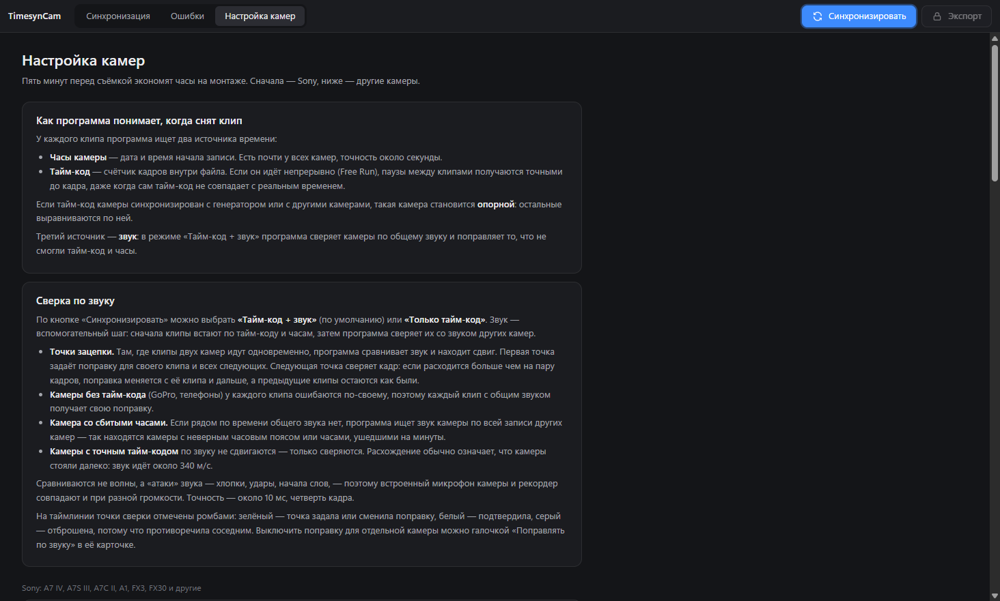

# Настройка камер

Пять минут перед съёмкой экономят часы на монтаже. Эта же справка есть в программе, на вкладке «Настройка камер».

## Sony: A7 IV, A7S III, A7C II, A1, FX3, FX30 и другие

### 1. Одинаковые часы на всех камерах

Одинаковые дата, время и часовой пояс, с точностью до секунды. Удобно выставлять по одному телефону: подготовьте время на минуту вперёд и подтвердите ровно в начале минуты.

Меню: `MENU → Настройка → Регион/дата/время`.

Во время съёмки часы не трогайте. Если камера «забыла» дату после смены аккумулятора — села внутренняя батарейка часов, поставьте камеру на зарядку.

### 2. Тайм-код: Free Run

`MENU → Съёмка → TC/UB → Time Code Run → Free Run` (на старых моделях `MENU → Настройка → Настройки TC/UB`).

В режиме **Rec Run** тайм-код идёт только пока камера пишет, и паузы между клипами пропадают — программе придётся брать время с часов, точность упадёт до секунды.

### 3. Тайм-код: Preset и текущее время

`Time Code Make → Preset`. В режиме Regenerate тайм-код продолжается с последнего клипа на карте и ведёт себя как Rec Run.

`Time Code Preset` — выставьте вручную примерно текущее время суток. Совпадать до кадра не обязательно: программа сама вычислит, на сколько тайм-код расходится с часами камеры. Зато так его удобно читать на монтаже.

После обновления прошивки тайм-код сбрасывается — выставьте его снова.

### 4. User Bit Time Rec — включить

`TC/UB → User Bit Time Rec → Вкл.` Камера дополнительно запишет время по часам. Это запасной источник на случай, если что-то пойдёт не так.

### 5. Звук на каждой камере

Даже если основной звук пишется отдельно, держите встроенный микрофон камеры включённым: по нему программа сверяет камеры между собой.

Проверьте в меню звука: `Запись звука → Вкл.` и `Уровень записи звука` — не на нуле. Если звук выключен, в файле будет тишина, и программа скажет: «в звуке тишина — сверить по звуку нельзя».

### 6. Хлопок в начале — и подгонка в программе

В начале съёмки и после каждого перерыва сделайте хлопок или вспышку так, чтобы их видели все камеры. Хлопок — отличная точка для сверки по звуку, а если звук не помог, по нему легко подогнать вручную:

1. Переключитесь в «Мультивью» и поставьте курсор на хлопок.
2. Стрелками ← → (по кадру, с Shift — по секунде) найдите кадр хлопка у опорной камеры.
3. У камеры, которая расходится, нажимайте «−1 к» / «+1 к» в её карточке, пока хлопок не совпадёт. Сдвиг применяется ко всем клипам камеры сразу.

На стадионе помните: звук идёт около 340 м/с. Если камеры стоят в 70 м друг от друга, звук придёт к ним с разницей примерно в 5 кадров. Поэтому подгоняйте по картинке.

### 7. Внешний тайм-код — опорная камера

FX3 (прошивка 2.00 и новее) и FX30 принимают тайм-код через кабель **VMC-BNCM1** от генератора (Tentacle Sync, Deity, RØDE Wireless PRO). У такой камеры тайм-код — это точное время, она становится опорной.

Если программа не распознала это сама, в карточке камеры выберите «Тайм-код: точный — синхронизирован».

Для A7 IV в справке Sony вход тайм-кода не упоминается. Для неё — часы, Free Run и хлопок.

### 8. Прокси — для быстрого предпросмотра

`MENU → Съёмка → Качество изображения → Настройки прокси → Прокси-запись: Вкл.`, формат **XAVC S HD** (H.264, 8 бит).

Оригиналы 4:2:2 10 бит встроенный плеер не проигрывает, поэтому без прокси клипы показываются стоп-кадрами. При 100p и 120p камера прокси не пишет.

### 9. Копируйте карту целиком

Вместе с файлами `C0001M01.XML` рядом с клипами: в них Sony записывает время съёмки и тайм-код. Не переименовывайте клипы и не пересохраняйте их — иначе ломается связь с XML и прокси.

Каждая камера — в свою папку. Несколько карт одной камеры можно перетащить на одну дорожку.

### S&Q

Замедленная и ускоренная съёмка (S&Q) не стыкуется по времени с другими камерами: длина клипа не совпадает с тем, сколько длилась запись. Программа подсветит такие клипы красным и предложит убрать их с таймлинии. Если нужен рапид — снимайте его в обычном режиме 100p/120p и замедляйте на монтаже.

## Canon, Panasonic, Fujifilm, Nikon, Blackmagic

В меню тайм-кода выберите **Free Run** (свободный счёт) и выставьте тайм-код по текущему времени, если камера это умеет. Часы — по одному источнику, как для Sony. Камеры с входом тайм-кода подключайте к генератору — они станут опорными.

## GoPro, DJI, экшн-камеры

Время на них выставляется с телефона при подключении к приложению (GoPro Quik, DJI Fly / Mimo) — подключите каждую камеру перед съёмкой. GoPro и часть камер DJI пишут местное время с пометкой UTC; программа это учитывает. Если камера всё равно уехала на целые часы, во вкладке «Ошибки» будет кнопка сдвига.

## iPhone и Android

Часы телефонов сверяются с сетью и обычно точны. Приложения вроде Blackmagic Camera дополнительно пишут тайм-код.

## Рекордеры звука

Zoom, Tascam, Sound Devices и другие пишут WAV с меткой времени (BWF). Перетащите папку рекордера на отдельную дорожку — он встанет по своему тайм-коду или часам. Выставьте на рекордере те же часы, что и на камерах.
